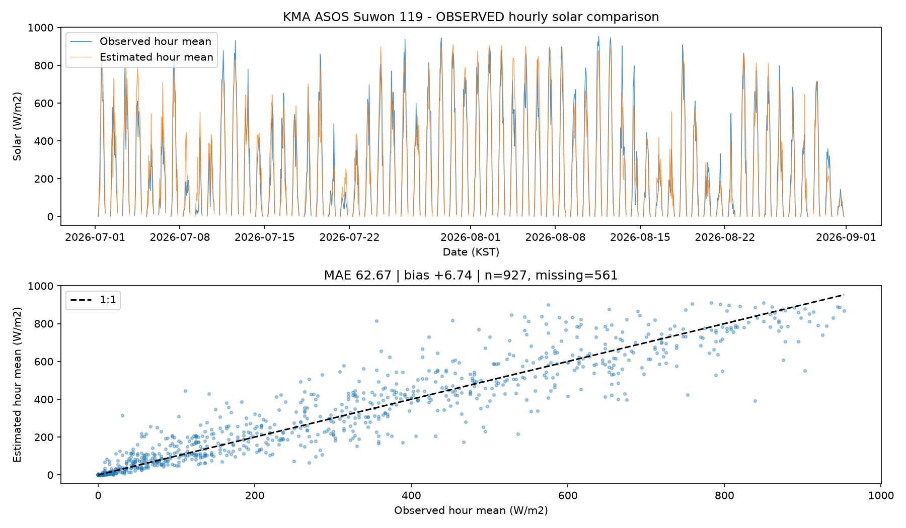

# 실제 ASOS 자료 반영 최종 보고

> 2026-10-11 재계산 안내: 이 문서의 수치는 작성 당시 기준입니다. 일사 구간 정렬·판정값 0.1℃ 반올림·동점 처리 고정 이후의 현재 수치는 [재계산 보고](recalc-2026-10-11.md)를 따릅니다.

2026-10-02. 요청한 A1~A6 완료. 건너뛴 항목 없음. 실제 배포·로그인·발송·수집 스크립트 실행·프로젝트 .env 읽기/출력 없음.

## 결과와 수용 기준

| 항목 | 변경·검증 결과 | 수용 기준 |
|---|---|---|
| A1 어댑터 | 수원119·62일·1488시간, 실제 필드/단위/KST/품질/결측, 인증 정보 없는 재현용 정규화 파일·원본 지문 보존 | 통과 |
| A2 일사 비교 | 실제927쌍, 결측561시간 제외, 같은 이전1시간 구간의 추정 평균·MAE/편향·그래프·최대 오차 공개 | 통과 |
| A3 전 날짜 재현 | 62개 날짜 전부 분석·하드 제약 검사·공통 경기 열 노출 비교·연기 별도·상위3일 추천 | 통과 |
| A4 화면·PDF | 기상청 관측 자료(수원119·날짜), 가상 대회/구장 구분, 고정 출처·원본 지문·일사 시간평균·전 페이지 고지 | 통과 |
| A5 오프라인 스냅샷 | 추천1순위7월10일의 저장 제안을 재풀이 없이 고정, 기존 합성 스냅샷 보존/구분, 완전 오프라인 전체 흐름 | 통과 |
| A6 발표 원고 | 7분 문구·3분 클릭 순서·질의응답·촬영 체크·출처5문서, 과거 합성 수치 혼입0건 | 통과 |

정책·운영값·안전 문구·솔버10초·기존 테스트는 유지했다. 기존 `docs/spec.md`, 정책 설정, EngineSettings, ScheduleSettings, 최적화 코드는 시작 커밋 대비 변경0건이다. 기존 테스트를 약화/삭제하지 않았고 실제 샘플 관련83개 검사를 추가했다.

## 샘플·시간·일사

- 입력 원본: `data/samples/asos_119_20260701_20260831.json` (수정하지 않음, Git 제외).
- SHA256: `3ec05108b47e104a4811a19bea81921c2d6e64e0008f8d3aa84a990605136ddf`.
- 2026-07-01 00:00~08-31 23:00, KST·정시24개/일·62일. 기온/습도/풍속1488시간 모두 존재, 전운량2시간 결측.
- `icsr`는 **정시 이전1시간의 일사 에너지MJ/m²**, 하루 누적값이 아니다. 내부 시간평균W/m²=`icsr×1,000,000/3,600`. 원 에너지·구간 시작/끝을 보존.0.0은 유효값.
- 제공 DOCX의 필드·단위, 사용자 샘플, [기상청 시간자료 설명](https://apihub.kma.go.kr/apiList.do?apiSeq=2), [국립기상과학원 원 관측 연구 §2.2~2.3](https://doi.org/10.14191/Atmos.2020.30.1.059)을 근거로 해석. 다른 API의 주소·변수명을 수집기에 옮기지 않았다.
- 자세한 해석·한계: [ASOS 관측 근거](kma/asos-observation-evidence.md). 관측소 정확 좌표·일사 결측 원인·다른 지점의 관측 여부를 추측하지 않았다.
- `data/observations/`에 필요한 공개 관측 필드만 보존하여 새 복제본도 키 없이 재현 가능. 원본의 URL·헤더·인증 관련 메타데이터를 옮기지 않는다.

## 실제 일사 비교

| 지표 | 값 |
|---|---:|
| 전체 시간 | 1488 |
| 비교 쌍(0 포함) | 927 |
| 제외한 일사 결측 시간 | 561 |
| MAE | 62.67W/m² |
| 편향(추정−관측) | +6.74W/m² |
| RMSE | 93.96W/m² |
| 최대 절대 오차 | 460.07W/m² |
| 양의 관측881시간만 MAE | 65.91W/m² |

기존 일사 감쇠식·계수를 유지하고 이전1시간을1분 중점 적분. 30초 적분과 차이0.05W/m² 미만 검사 통과. 결측은 비교와 그래프에서 제외하며0으로 채우지 않는다.

[정량 지표](real-data/solar/solar-metrics.json) · [927개 비교 쌍](real-data/solar/solar-pairs.json).
평균 편향이 작아도 개별 시간 편차는 크다. 결과를 개선하려고 계수나 운영값을 조정하지 않았다. 정시 운량/강우를 직전 한 시간 동안 일정하다고 두며 기존 가상 구장A 좌표·고도0 가정을 쓴다. 이는 일사 비교이며 **현장 WBGT 정확도 검증이 아니다**.

## 시연 후보

연기 수 최소 → 원래 중지 단계였다가 배정된 경기 수 최대 → 공통 열 노출 감소 최대 → 날짜 오름차순. 모든 날짜에 같은 정책/운영값을 적용한 뒤 선택했다. 최고WBGT는24시간·가상3구장 전체의 추정 중앙값 최대(구장/표면 보정 포함)이며 유소년 판정은 상단값이다.

| 순위 | 날짜 | 배정 | 연기 | 원래 중지→배정 | 공통 경기 점수 원래→제안 | 최고 WBGT 추정℃ | 상태 |
|---|---|---:|---:|---:|---|---:|---|
| 1 | 2026-07-10 | 15 | 0 | 10 | 6114→4319 | 32.043 | OPTIMAL |
| 2 | 2026-07-18 | 15 | 0 | 9 | 6665→4295 | 32.591 | OPTIMAL |
| 3 | 2026-07-06 | 15 | 0 | 9 | 6041→4453 | 31.121 | OPTIMAL |

추천1순위 **7월10일**은 원래 중지 단계10경기를 이동해15경기 모두 배정. 공통15경기 점수6114→4319(29.36% 감소)이며 건강 효과/사고 감소율이 아니다. [날짜별 JSON과 연기 사유](real-data/replay-results.json).

61일OPTIMAL, 7월9일FEASIBLE(15경기 배정, 비용 최적성 미확정), 폴백0. 16일 전부 배정. 62회 가상 재현 누적562배정/368연기. 최장10.254초는 준비·결과 검사 포함 시간이고 솔버 탐색 제한10초를 늘리지 않았다.
연기 수의 최적해와 특정 경기의 연기가 유일한 선택인지는 구분한다. 다른 경기를 대신 연기하는 해가 있을 수 있어 모든 개별 연기를 불가피하다고 단언하지 않는다. 기존 P3 통제 무더위의 연기 경기 강제 배정INFEASIBLE 검사는 유지·통과했다.

## 62일 전체 날짜 표

두 점수는 각 날짜의 같은 공통 경기 집합으로만 계산. 전부 연기되어 공통 경기가0이면 두 점수도0이며 개선률을 계산하지 않는다.

| 날짜 | 배정 | 연기 | 공통 경기 | 원래 점수 | 재편성 점수 | 최고 WBGT 추정℃ | 상태 |
|---|---:|---:|---:|---:|---:|---:|---|
| 2026-07-01 | 14 | 1 | 14 | 5843 | 3229 | 30.835 | OPTIMAL |
| 2026-07-02 | 15 | 0 | 15 | 4643 | 3349 | 29.779 | OPTIMAL |
| 2026-07-03 | 14 | 1 | 14 | 5851 | 3436 | 30.595 | OPTIMAL |
| 2026-07-04 | 13 | 2 | 13 | 6135 | 3744 | 30.828 | OPTIMAL |
| 2026-07-05 | 15 | 0 | 15 | 4401 | 3780 | 29.503 | OPTIMAL |
| 2026-07-06 | 15 | 0 | 15 | 6041 | 4453 | 31.121 | OPTIMAL |
| 2026-07-07 | 7 | 8 | 7 | 3653 | 1942 | 32.942 | OPTIMAL |
| 2026-07-08 | 15 | 0 | 15 | 4112 | 3905 | 28.075 | OPTIMAL |
| 2026-07-09 | 15 | 0 | 15 | 3451 | 3139 | 28.656 | FEASIBLE |
| 2026-07-10 | 15 | 0 | 15 | 6114 | 4319 | 32.043 | OPTIMAL |
| 2026-07-11 | 3 | 12 | 3 | 1755 | 1047 | 35.041 | OPTIMAL |
| 2026-07-12 | 3 | 12 | 3 | 1758 | 1023 | 35.122 | OPTIMAL |
| 2026-07-13 | 3 | 12 | 3 | 1739 | 954 | 34.023 | OPTIMAL |
| 2026-07-14 | 11 | 4 | 11 | 5619 | 3351 | 31.478 | OPTIMAL |
| 2026-07-15 | 15 | 0 | 15 | 4362 | 3847 | 29.439 | OPTIMAL |
| 2026-07-16 | 13 | 2 | 13 | 6918 | 3480 | 33.342 | OPTIMAL |
| 2026-07-17 | 7 | 8 | 7 | 4158 | 2050 | 33.703 | OPTIMAL |
| 2026-07-18 | 15 | 0 | 15 | 6665 | 4295 | 32.591 | OPTIMAL |
| 2026-07-19 | 12 | 3 | 12 | 5365 | 3084 | 31.663 | OPTIMAL |
| 2026-07-20 | 15 | 0 | 15 | 4448 | 3944 | 29.961 | OPTIMAL |
| 2026-07-21 | 15 | 0 | 15 | 4080 | 3964 | 28.305 | OPTIMAL |
| 2026-07-22 | 11 | 4 | 11 | 5254 | 3039 | 32.220 | OPTIMAL |
| 2026-07-23 | 7 | 8 | 7 | 3779 | 2155 | 32.731 | OPTIMAL |
| 2026-07-24 | 4 | 11 | 4 | 2119 | 1107 | 33.570 | OPTIMAL |
| 2026-07-25 | 3 | 12 | 3 | 1622 | 930 | 32.964 | OPTIMAL |
| 2026-07-26 | 3 | 12 | 3 | 1798 | 927 | 35.092 | OPTIMAL |
| 2026-07-27 | 4 | 11 | 4 | 2106 | 1310 | 32.991 | OPTIMAL |
| 2026-07-28 | 3 | 12 | 3 | 1671 | 906 | 34.062 | OPTIMAL |
| 2026-07-29 | 4 | 11 | 4 | 2315 | 1212 | 33.432 | OPTIMAL |
| 2026-07-30 | 4 | 11 | 4 | 2158 | 1120 | 33.356 | OPTIMAL |
| 2026-07-31 | 3 | 12 | 3 | 1805 | 852 | 34.855 | OPTIMAL |
| 2026-08-01 | 3 | 12 | 3 | 1711 | 996 | 34.967 | OPTIMAL |
| 2026-08-02 | 3 | 12 | 3 | 2229 | 1002 | 36.060 | OPTIMAL |
| 2026-08-03 | 3 | 12 | 3 | 2085 | 885 | 37.194 | OPTIMAL |
| 2026-08-04 | 0 | 15 | 0 | 0 | 0 | 37.034 | OPTIMAL |
| 2026-08-05 | 0 | 15 | 0 | 0 | 0 | 37.604 | OPTIMAL |
| 2026-08-06 | 0 | 15 | 0 | 0 | 0 | 38.062 | OPTIMAL |
| 2026-08-07 | 3 | 12 | 3 | 2073 | 972 | 36.966 | OPTIMAL |
| 2026-08-08 | 10 | 5 | 10 | 6665 | 3252 | 35.100 | OPTIMAL |
| 2026-08-09 | 10 | 5 | 10 | 4850 | 2751 | 32.253 | OPTIMAL |
| 2026-08-10 | 11 | 4 | 11 | 5478 | 3088 | 31.494 | OPTIMAL |
| 2026-08-11 | 10 | 5 | 10 | 4854 | 2690 | 32.192 | OPTIMAL |
| 2026-08-12 | 15 | 0 | 15 | 5581 | 3586 | 30.325 | OPTIMAL |
| 2026-08-13 | 11 | 4 | 11 | 5039 | 3274 | 31.751 | OPTIMAL |
| 2026-08-14 | 10 | 5 | 10 | 4589 | 2747 | 33.798 | OPTIMAL |
| 2026-08-15 | 14 | 1 | 14 | 6220 | 4012 | 31.191 | OPTIMAL |
| 2026-08-16 | 15 | 0 | 15 | 4405 | 3925 | 28.587 | OPTIMAL |
| 2026-08-17 | 15 | 0 | 15 | 5305 | 4083 | 31.595 | OPTIMAL |
| 2026-08-18 | 4 | 11 | 4 | 2204 | 983 | 33.113 | OPTIMAL |
| 2026-08-19 | 11 | 4 | 11 | 6451 | 3249 | 37.332 | OPTIMAL |
| 2026-08-20 | 14 | 1 | 14 | 5540 | 4057 | 32.140 | OPTIMAL |
| 2026-08-21 | 15 | 0 | 15 | 5124 | 4049 | 30.263 | OPTIMAL |
| 2026-08-22 | 15 | 0 | 15 | 6055 | 4103 | 32.965 | OPTIMAL |
| 2026-08-23 | 4 | 11 | 4 | 2383 | 961 | 35.235 | OPTIMAL |
| 2026-08-24 | 3 | 12 | 3 | 1977 | 813 | 34.569 | OPTIMAL |
| 2026-08-25 | 4 | 11 | 4 | 2292 | 1024 | 33.791 | OPTIMAL |
| 2026-08-26 | 3 | 12 | 3 | 1853 | 867 | 34.175 | OPTIMAL |
| 2026-08-27 | 7 | 8 | 7 | 3793 | 1916 | 33.899 | OPTIMAL |
| 2026-08-28 | 14 | 1 | 14 | 7195 | 4056 | 32.621 | OPTIMAL |
| 2026-08-29 | 11 | 4 | 11 | 6187 | 3365 | 33.020 | OPTIMAL |
| 2026-08-30 | 13 | 2 | 13 | 5696 | 3686 | 30.946 | OPTIMAL |
| 2026-08-31 | 15 | 0 | 15 | 4292 | 3793 | 28.385 | OPTIMAL |

## 화면·PDF·오프라인

- 일반 관측: 첫 화면의 **기상 자료 → 기상청 관측 자료 · 수원119**, 추천일7월10일 → 재현 실행.7~8월 모든 날짜를 선택할 수 있다. 없는 날짜/불완전 자료는 합성으로 대체하지 않고 거부한다.
- 관측 고정 시연: [관측 스냅샷](http://127.0.0.1:8000/#snapshot-observed). 실제 관측 입력·사전 계산·가상 대회·WBGT 추정을 구분한다. 날짜·설정·가상 판단 사유 고정. API·솔버·실제 발송 없음.
- 기존 [합성 스냅샷](http://127.0.0.1:8000/#snapshot)은 별도 보존. 기존 합성 JSON/내보내기 파일 변경 없음. 두 입력 지문이 다른지 검사.
- 관측 입력 지문: `e7272a4e9f469957a873ddda1d0c120725d8e0a1519c0229805e65143a3115bc`.
- 관측 PDF: `data/output/real/observed-snapshot.pdf`,26페이지·105466바이트. Git에는 스냅샷 내보내기 묶음으로 보존되어 앱에서도 동일 파일 다운로드 가능. 전 페이지 렌더링/경계 검사(위반0)·접촉시트·첫/경기 페이지 확대 확인. 한글 글꼴 포함, **본 자료는 의사결정 보조용 추정값** 전 페이지 유지.
- 화면·읽기 전용 팀 화면·PDF/CSV/고정 입력의 **기상청 관측 자료(수원119·날짜)** 검사. 관측 PDF에 과거 합성 정확도 보류 문구가 남아 있지 않음.
- 일반/관측 오프라인 E2E 이미지·다운로드 PDF: `data/output/real/`. 데스크톱/휴대폰 크기 확인·화면 넘침0. 타임라인은 내부 스크롤.
- 저장 완료 후 완전 오프라인 새로고침과 재현→히트맵→경기 상세→재편성 승인→모의 알림→PDF→읽기 전용 일정 통과. 관측 스냅샷 API 요청0. 다운로드PDF SHA256은 고정PDF와 동일.
- 최초 방문/캐시 삭제 후에는 정적 파일을 제공할 로컬 서버가 필요. Safari 등 실제 기기 브라우저는 사용자 추가 확인 필요.
- 빌드 성공·크기 경고0, 최대JS 청크369.72kB. 관측JSON은 정적 자산523.22kB(gzip34.07kB)으로 분리·캐시했다. 경고 기준을 올리지 않았다.
- Docker에는 인증 정보를 제거한 정규화 관측·지점 표·추천 메타데이터만 추가. 실제 Docker 실행/배포는 하지 않았다.

## 실제 테스트 실행

| 작업 단위 | 실행·결과 |
|---|---|
| A1 | 전체pytest150개 통과·13.10초 |
| A2 | 전체153개 통과·15.23초, 최종 그래프 변경 후 관련3개 재실행 통과 |
| A3 | 62일 분석 자체의 제약/집합/사유 검사, 관련75개·전체218개 통과(14.94초) |
| A4+A5 | 최종 전체pytest **223개 통과·18.66초**, 관련PDF/스냅샷 검사, 빌드 통과 |
| 브라우저 | 데스크톱/모바일 × 합성·관측 일반/오프라인·캐시 교체 ×3회 = **30개 통과·1.3분** |
| A6 | 관련71개 통과·7.08초, 발표5문서 수치6개/로컬 링크4개/7분·3분 구성 검사 통과 |
| 최종 보고 | 전체62개 날짜 행·로컬 링크28개 대조 통과, 관련71개 재실행 통과·16.38초 |

같은 검사를 단계마다 재실행했으므로 위 수를 합산해 서로 다른 테스트 개수라고 주장하지 않는다. 최종 Python 테스트223개(기존140개+추가83개), 브라우저 반복 실행30회다.
기존 TestClient 사용 중단 예정 경고1건과 Playwright 실행의 Node 색상 환경 경고가 남아 있다. 동작을 바꾸는 패키지 교체는 하지 않았다.
신규 검사에서 지점 표의 소속 기관과 경기 시간의 일사 결측 유무를 잘못 가정한 실패가 있었으며, 실제 표 전체 검사·일 전체 결측 요약·야간 결측PDF 검사로 수정/강화 후 통과했다. 기존 테스트 약화/삭제 없음.3회 수정 실패·명세 충돌·진행 불가로 건너뛴 작업 없음.

## 작업 단위별 커밋·보고

| 커밋 | 내용 | 보고 |
|---|---|---|
| 62f5df3 | 실제 ASOS 어댑터·근거·정규화·샘플 테스트 | [A1](real-data/a1-adapter.md) |
| f459443 | 실제 일사 비교·MAE/편향/그래프 | [A2](real-data/a2-solar.md) |
| cca7f7e | 62일 재현·후보 순위·API | [A3](real-data/a3-replays.md) |
| bdf86bd | 관측 화면/PDF·추천일 오프라인 스냅샷·반복E2E | [A4](real-data/a4-ui-pdf.md), [A5](real-data/a5-snapshot.md) |
| f029b4f | 실제 관측으로 발표 원고 갱신·정합성 검사 | [A6](real-data/a6-presentation.md) |
| 본 보고서의 최종 커밋 | `docs: consolidate real-data results and verification report` | 이 문서 |

마지막 행의 해시는 이 파일을 포함하는 커밋이므로 파일 안에 자기 자신의 해시를 넣지 않는다. 완료 직후 `git log -1 --oneline`로 확인 가능. 최종 보고 커밋 후 멈춘다.

## 직접 확인할 항목 (전체 모음)

- [ ] 제공한 원본SHA256·수원119·62일1488시간, `icsr` 이전1시간MJ/m²/시간평균 변환 근거 확인.
- [ ] 일사 그래프의 큰 편차·561시간 제외·0유효값 확인. 정시 운량/강우를 한 시간 동안 고정하는 근사, 순간WBGT 입력에 시간평균을 사용하는 한계 확인.
- [ ] 관측소1곳을 가상3구장에 공유하는 공간 차이와 기압/고도/풍속 높이 가정 확인. 현장 WBGT 검증은 별도.
- [ ] README대로 서버를 실행해 일반 관측 재현·추천일7월10일·히트맵·상세·15배정/0연기·경기 이동·휴식·선행 경기·일몰 확인.
- [ ] 다른 날짜의 연기 결과도 확인. 공통 경기 점수와 연기 수를 구분하고 최고WBGT가24시간/전체구장의 추정 중앙값 최대라는 점 확인.
- [ ] 화면·팀 읽기 전용·PDF 첫/경기 페이지에 기상청 수원119·날짜, 가상 대회/구장·WBGT 추정·안전 고지가 정확한지 확인.
- [ ] 관측 스냅샷 저장 완료→새로고침→연결 끊기→전체 시연·PDF 다운로드. 최초 방문/캐시 삭제 시 서버 필요 조건과 실제 기기 브라우저 추가 확인.
- [ ] 기존 합성 스냅샷과 관측 스냅샷이 다른 모드인지 확인. 고정된 승인 예시를 실제 운영 판단으로 소개하지 않기.
- [ ] 발표를 직접 읽어7분/시연3분 리허설. 실제 관측 입력·가상 대회·WBGT 추정·사전 계산을 구분하고 열 노출 감소를 건강 효과로 표현하지 않기.
- [ ] 사용자가 영상·외부 서비스 링크·현장 WBGT 대조·전문가 자문을 별도로 준비. 실제 배포/발송/로그인/수집은 이번 작업에 포함하지 않음.

재실행 명령은 [README](../README.md), 원고는 [발표](presentation/slides.md)·[클릭 순서](presentation/demo-script.md)·[질의응답](presentation/qa.md) 참조.
