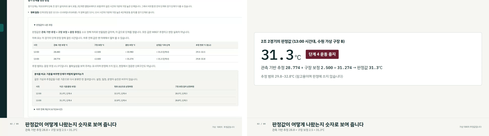

# 제출 준비 보고 (2026-10-21)

판정 기준을 (나)로 바꾸고 제출 준비를 진행한 기록이다. 단계마다 이 문서에 이어서 적는다. 모든 WBGT 수치는 관측 기상으로 계산한 추정값이며, 대회와 팀과 구장은 가상 예시다. 의사결정 보조용이고, 가상 대회로 검증한 시제품이며 현장 실측과 도입 실적은 없다.

## 요약: 바뀐 판정 기준과 세 장면

판정 기준을 (나)로 바꿨다. 판정값은 관측 기반 WBGT 추정에 구장 보정 +2.5℃를 더한 **중앙 추정**이다(이전: 유소년은 추정 범위 상단). 단계 경계 21/25/28/31℃, 구장 보정, 범위(±1.5℃, 화면과 기록에 참고로 표시), 최적화 목표와 제약은 그대로다. 바꾼 설정은 `backend/config/policies.yaml`의 `age.upper_bound_groups` 한 줄이고 엔진과 스케줄러 코드는 고치지 않았다.

| 장면 | 원래 단계 (0·1·2·3·4) | 배정 / 연기 | 재편성 후 단계 | 열 노출 점수 (공통 경기) | 최고 판정값 |
|---|---|---|---|---|---|
| 8/10 (`#snapshot-observed`) | 0·0·0·11·4 | 15 / 0 | 0·0·0·15·0 | 5,273 → 4,153 (15) | 31.3℃ |
| 8/8 (`#snapshot-observed-0808`) | 0·0·1·0·14 | 10 / 5 (1조 2경기, 4조 1경기, 준결승 1, 준결승 2, 결승) | 0·0·0·10·0 | 5,993 → 2,648 (10) | 34.8℃ |
| 8/8~8/9 (`#snapshot-observed-0808-2day`) | 0·0·1·0·14 | 15 / 0 | 0·0·2·13·0 | 8,608 → 3,681 (15) | 34.8℃ |

모두 CP-SAT OPTIMAL이다. 8/10과 8/8은 5회 반복에서 매번 같은 일정이었다.

## 1. 판정 기준 변경과 수치 다시 고정

### 1-1. 바꾸기 전 고정값 (2026-10-21 변경 직전 회귀 테스트에 잠긴 값)

출처: 변경 직전 커밋 `755c318`의 `tests/fixtures/display-baseline-2026-08-10.json` (8/10 관측 스냅샷과 새로 돌린 재현이 일치한 값). 판정 기준은 "구장 보정 +2.5℃, 유소년은 추정 범위 상단으로 판정"이었다.

| 항목 | 값 |
|---|---|
| 날짜, 관측소, 대회 | 2026-08-10, 수원 119, 가상 U12 12팀·3구장·15경기 |
| 원래 일정 단계별 경기 수 (0·1·2·3·4) | 0·0·0·1·14 |
| 배정 / 연기 | 13 / 2 (준결승 2, 결승) |
| 재편성 후 단계 (0·1·2·3·4) | 0·0·0·13·0 |
| 열 노출 점수 (공통 13경기) | 6442 → 3879 |
| 최고 판정값 | 32.8℃ (13:00 구장 A) |

구장 A 운영 시간대 값(이전 기준):

| 시각 | 단계 | 중앙 추정 | 범위 | 판정값(범위 상단) |
|---|---|---:|---|---:|
| 07:00 | 3 | 27.128 | 25.628~28.628 | 28.6 |
| 08:00 | 3 | 29.278 | 27.778~30.778 | 30.8 |
| 09:00 | 3 | 29.017 | 27.517~30.517 | 30.5 |
| 10:00 | 4 | 30.335 | 28.835~31.835 | 31.8 |
| 11:00 | 4 | 30.680 | 29.180~32.180 | 32.2 |
| 12:00 | 4 | 30.983 | 29.483~32.483 | 32.5 |
| 13:00 | 4 | 31.274 | 29.774~32.774 | 32.8 |
| 14:00 | 4 | 30.264 | 28.764~31.764 | 31.8 |
| 15:00 | 4 | 30.284 | 28.784~31.784 | 31.8 |
| 16:00 | 4 | 29.646 | 28.146~31.146 | 31.1 |
| 17:00 | 3 | 28.893 | 27.393~30.393 | 30.4 |
| 18:00 | 3 | 28.143 | 26.643~29.643 | 29.6 |
| 19:00 | 3 | 27.022 | 25.522~28.522 | 28.5 |
| 20:00 | 3 | 26.947 | 25.447~28.447 | 28.4 |

### 1-2. 설정 변경과 8/10 스냅샷

- 바꾼 설정은 `backend/config/policies.yaml`의 `age.upper_bound_groups` 한 줄이다(`[U10, U12, U15, senior]` → `[]`). 엔진과 스케줄러 코드는 고치지 않았다. 단계 경계(21/25/28/31℃), 구장 보정 +2.5℃, 범위 계산(±1.5℃), 최적화 목표와 제약은 그대로다.
- 이 설정을 그대로 비춘 화면 쪽 사본(`frontend/src/decision-breakdown.js`의 `UPPER_BOUND_GROUPS`)도 `[]`로 맞췄다. 같은 설정을 쓰는 "연령 단계 상향" 옵션은 상단 판정 연령에만 적용되므로 지금 기준에서는 효과가 없어, 설정 화면에서 비활성으로 두고 이유를 적었다.
- 8/10 관측 스냅샷을 다시 만든 결과는 지난번 민감도 표의 (나)와 모두 같다.

| 항목 | 기대값 (지난 민감도 (나)) | 실행 결과 |
|---|---|---|
| 원래 일정 단계 (0·1·2·3·4) | 0·0·0·11·4 | 0·0·0·11·4 |
| 배정 / 연기 | 15 / 0 | 15 / 0 |
| 재편성 후 단계 | 15경기 모두 3 | 0·0·0·15·0 |
| 열 노출 점수 | 5273 → 4153 | 5273 → 4153 (공통 15경기) |
| 최고 판정값 | 31.3℃ | 31.3℃ (13:00 구장 A) |
| 결과 표기 | OPTIMAL | OPTIMAL, 5회 반복 모두 OPTIMAL이고 같은 일정(솔버 최대 1.99초) |

### 1-3. 8/8 관측 스냅샷(두 번째 장면)

같은 가상 대회, 같은 관측소(수원 119), 같은 기준이다. 결과는 기대값과 모두 같다.

| 항목 | 기대값 | 실행 결과 |
|---|---|---|
| 원래 일정 단계 | 0·0·1·0·14 | 0·0·1·0·14 |
| 배정 / 연기 | 10 / 5 | 10 / 5 |
| 연기 경기 | 1조 2경기, 4조 1경기, 준결승 1, 준결승 2, 결승 | 같음 |
| 열 노출 점수 | 5993 → 2648 | 5993 → 2648 (공통 10경기) |
| 최고 판정값 | 34.8℃ | 34.8℃ (13:00 구장 A) |
| 반복 확인 | | 5회 모두 OPTIMAL, 같은 일정(솔버 최대 0.61초) |

재현 화면(스냅샷 모드)에 "시연 장면" 선택을 두었다: "8월 10일: 재편성으로 전부 소화하는 날"(`#snapshot-observed`), "8월 8일: 재편성해도 연기가 생기는 날"(`#snapshot-observed-0808`), "8월 8~9일: 같은 대회를 이틀 일정으로 다시 짠 경우"(`#snapshot-observed-0808-2day`). 참가팀 화면은 각 주소 뒤에 `-team`을 붙인다.

### 1-4. 8/8~8/9 이틀 일정

현재 기능(대회 종료일을 하루 늘린 같은 가상 대회)으로 된다. 15경기 모두 배정, 연기 0, 재편성 후 단계 0·0·2·13·0, 열 노출 점수 8608 → 3681(공통 15경기), OPTIMAL. 8/8에 연기 후보였던 5경기(1조 2경기, 4조 1경기, 준결승 1, 준결승 2, 결승)는 모두 8/9로 간다(2조 2경기와 3조 2경기도 8/9 오전으로 옮겨지고 8/8에는 8경기가 남는다). 이 결과를 세 번째 스냅샷으로 만들고, 8/8 대시보드의 연기 경기 상자에 "이틀 일정으로 다시 짜면" 링크를 달았다.

- 바로잡음: 작업 중 별도 DB에서 경기 ID에 접두어를 붙여 먼저 돌렸을 때는 4조 1경기가 8/8 17:00에 배정되었다. 동점 처리 값이 경기 ID에 따라 달라 다른 최적해가 나온 것이다. 스냅샷과 회귀 테스트는 원래 ID로 새로 돌린 실행 결과를 따르며, 이 결과가 두 번 실행에서 같았다.
- 지난번 8/10~8/11 이틀 일정은 새 기준에서 8/10에 연기가 없으므로 스냅샷으로 만들지 않았고, 문서에 남은 관련 문구도 없다.

### 1-5. 회귀 테스트 다시 고정

`scripts/freeze_display_baseline.py`가 세 장면 각각에 대해 커밋된 스냅샷과 새로 돌린 재현이 일치할 때만 `tests/fixtures/display-baseline-2026-08-10.json`, `-2026-08-08.json`, `-2026-08-08-2day.json`을 쓴다. 대상은 배정과 연기 수, 연기 경기, 원래와 재편성 후 단계별 경기 수, 열 노출 점수 전후, 최고 판정값, 구장과 시간마다의 단계, 중앙 추정, 범위 하단과 상단, 판정값 전부(하루 72칸, 이틀 144칸)와 경기별 권고와 제안이다. `tests/test_display_baseline.py`(12개)는 머리 수치, 판정값이 중앙 추정의 반올림인지, 스냅샷 일치, 새 재현 일치를 장면마다 검사한다.

- 확인 사항: 이틀 장면의 8/9 08:00 칸은 저장된 중앙 추정이 26.950인데 구장 A 판정값이 26.9, 구장 B는 27.0이다. 저장값은 소수 셋째 자리로 반올림된 값이고 판정은 반올림 전 값으로 하기 때문이다(단계는 둘 다 2). 엔진은 고치지 않았고, 테스트는 ±0.0005 안에서 판정값이 맞는지 검사한다.

### 1-6. 62일 분석과 민감도 (새 기준)

| 62일 (가상 12팀, 930경기) | 이전 기준 (가) | 새 기준 (나) |
|---|---|---|
| 배정 / 연기 | 555 / 375 | 699 / 231 |
| 전부 / 일부 / 0경기 배정 일수 | 15 / 37 / 10 | 28 / 32 / 2 (8/4, 8/6) |
| CP-SAT 첫 실행 | OPTIMAL 62 | OPTIMAL 62 |
| 최고 판정값 | 39.7℃ (8/19) | 38.2℃ (8/19) |
| 31℃ 이상인 날의 선정 규칙 1순위 | 8/10 | 8/11 (8/10은 2순위, 작성자 결정으로 8/10 유지) |
| CP-SAT 대 기존 탐욕(배정 합계) | 555 대 489 | 699 대 609 |
| 같은 입력 재실행(12팀 62조건) | 555 = 555 | 699 = 699 (OPTIMAL 58, FEASIBLE 4) |
| 16팀 2일 31구간(엔진 대 단순) | 593 대 583 | 710 대 701 (OPTIMAL 10, FEASIBLE 12, 단순 방식 선택 9) |

민감도(62일, 전부 배정 / 미완료 / 0배정 / 배정 합계). 지금 판정 기준은 (나)다.

| 조건 | 가정 이름 | 이전 실행 | 새 실행 |
|---|---|---|---|
| (나) 보정 +2.5℃, 중앙 추정 (지금 기준) | `baseline` (이전 `central_only`) | 28 / 34 / 2 / 699 | 28 / 34 / 2 / 699 |
| (가) 보정 +2.5℃, 범위 상단 (이전 기준) | `upper_bound` (이전 `baseline`) | 15 / 47 / 10 / 555 | 15 / 47 / 10 / 555 |
| (다) 보정 없음, 중앙 추정 | `offset_0` (이전 `offset_0_central`) | 48 / 14 / 0 / 878 | 48 / 14 / 0 / 878 |
| 보정 없음, 범위 상단 | `offset_0_upper` (이전 `offset_0`) | 36 / 26 / 1 / 780 | 36 / 26 / 1 / 780 |
| 보정 +1.25℃, 중앙 추정 | `offset_1.25` | (이전은 상단 판정 25 / 37 / 4 / 678) | 39 / 23 / 1 / 793 |
| 보정 +3.75℃, 중앙 추정 | `offset_3.75` | (이전은 상단 판정 9 / 53 / 19 / 397) | 16 / 46 / 10 / 577 |
| 3구장 모두 −1℃ | `site_lower_1` | 23 / 39 / 5 / 651 | 36 / 26 / 1 / 780 |
| 3구장 모두 +1℃ | `site_upper_1` | 11 / 51 / 17 / 435 | 19 / 43 / 7 / 606 |
| A−1, B0, C+1℃ | `site_heterogeneous_1` | 18 / 44 / 5 / 595 | 31 / 31 / 1 / 740 |
| A+1, B0, C−1℃ | `site_heterogeneous_reverse_1` | 18 / 44 / 6 / 592 | 31 / 31 / 2 / 736 |

같은 조건끼리는 이전과 새 실행이 정확히 같아, 판정값 선택 말고는 계산이 달라지지 않았음을 확인했다. 시연 이틀의 (가)(나)(다) 표는 `data/output/demo-numbers.md`에 있고 지난번 민감도 보고와 같다(8/10: 13/2, 15/0, 15/0; 8/8: 7/8, 10/5, 13/2). 이전과 이후의 모든 표는 [2026-10-21 재계산](recalc-2026-10-21.md)에 있다.

### 1-7. 판정 근거 화면

경기 상세의 "판정값이 나온 과정"은 경기가 걸친 시간마다 "관측 기반 추정 + 구장 보정 = 중앙 추정 = 판정값(단계)"을 적고, 추정 범위는 같은 줄 끝에 "참고"로 둔다. 하루 전체 계산식은 접힌 영역에서 펼친다. 분석용 비교 상자는 같은 값을 기존 함수(`counterLevel`, 백엔드 `classify`와 같은 규칙)로 다시 분류해 "범위 상단으로 판정하면"과 "구장 보정 없이 판정하면"의 판정값과 단계를 보여 준다. PDF의 계산식 문장도 같은 순서로 바꾸고 "분석용 비교: 범위 상단으로 판정하면 …"을 붙였다. PDF 첫 페이지에 "판정 기준:" 문장을 넣었다.

### 1-8. 원래 일정의 하드 제약 위반

새 기준과 새 스냅샷에서 기존 `validate()`로 다시 확인했다. 8/10은 운동 중지 시간대에 배정된 경기 4개(1~4조 2경기)와 경기 쌍 5개(같은 구장 정리 시간 부족 3쌍, 진출 가능 팀 휴식 부족 2쌍)다. 8/8과 8/8~8/9는 운동 중지 시간대 경기 14개와 같은 경기 쌍 5개다. 중지 시간대 경기 수는 각 장면의 원래 단계 4 경기 수와 같다.

### AGENTS.md

AGENTS.md에는 "유소년은 범위 상단으로 판정"이라는 문장이 없어 고치지 않았다. 같은 설명이 있던 곳은 `docs/spec.md` 3곳(36, 173, 391행 근처)이며, 새 기준과 이전 기준을 함께 적도록 고쳤다.

## 2. 발표자료용 수치 파일

`scripts/export_demo_numbers.py`가 커밋된 장면 스냅샷, `docs/real-data/replay-results.json`, `docs/wbgt-sanity/sensitivity-results.json`, 정책 설정에서 값을 뽑아 `data/output/demo-numbers.json`과 같은 내용의 `data/output/demo-numbers.md`를 만든다(`data/output/`은 Git 제외). 장면별 날짜, 관측소, 운영시간 최고기온과 습도 범위, 구장 A의 시간대별 판정값과 중앙 추정과 범위와 단계, 원래와 재편성 후 단계 분포, 배정과 연기, 연기 경기와 화면 사유, 열 노출 점수, 결과 표기와 계산 시간, 모의 알림 수, 경기별 표, 원래 일정의 제약 위반 목록, 판정 근거 예시, (가)(나)(다) 표, 62일과 민감도 표, 기준을 담는다. (가)(나)(다) 표는 민감도와 같은 분석 함수로 그 자리에서 다시 풀어 만든다. 판정 근거 예시는 원래 일정에서 가장 높은 단계였던 경기의 단계 판정 창에서 가장 높은 판정값 칸이다(8/10은 2조 2경기의 13:00 칸, 28.774 + 2.5 = 31.274 → 31.3℃).

## 3. 제품 보강

### 3-1. 첫 화면

빈 주소로 열면 `#snapshot-observed`로 바뀌며 8/10 장면의 대시보드가 바로 열린다. 서버와 연결된 재현은 `#live`이고, 이 화면의 기상 자료 기본 선택은 기상청 관측이다. 합성 날씨는 사이드바 "다른 시연"의 "합성 날씨(기능 시험용)"로 옮겼다.

### 3-2. README

커밋되지 않았던 README 변경(`git diff README.md` 기준): 368줄 문서를 82줄로 줄인 판으로, 296줄이 지워지고 10줄이 바뀌었다. 첫머리에 "기상은 mock 합성 자료이며 실제 2026년 관측 재현이나 현장 정확도 검증을 완료한 상태는 아닙니다"가 들어가 있었고, 시연 순서가 합성 8/1 기준이었다. 실제 관측 재현, 관측 스냅샷, ASOS 수집 절차, 최신 관측 연결, 1코어 검증, 근거 묶음 재생성 절의 내용이 빠져 있었다. 이 문장들은 지금 상태(관측 재현 62일과 관측 스냅샷이 있음)와 맞지 않아 쓰지 않았다.

새 README는 무엇을 하는 도구인지, 관측 스냅샷 세 장면과 주소, 판정 기준(중앙 추정, 보정 +2.5℃, 범위는 참고), 설치와 실행, 정적 시연판, 테스트, 관측 자료로 다시 만드는 순서, 활용 영상 다시 만들기, ASOS 수집(사용자 실행), 검증한 것과 하지 않은 것, 출처와 한계, 라이선스를 담았다. 지워진 판에서 지금도 맞는 설치 명령, 설정 화면 설명, `.env` 처리, 출처와 한계, 라이선스 고지는 살렸다.

### 3-3. 서체 서브셋

`scripts/build_font_subset.py`가 설치된 @fontsource 파일에서 KS X 1001 한글 2,350자, 출력 가능한 ASCII, 앱 문구(`frontend/src`와 `index.html`을 훑은 538자)만 남겨 굵기 400과 700의 WOFF 두 개를 만든다. 프로젝트 환경에 Brotli 인코더가 없어 WOFF2가 아닌 WOFF다. `--check`와 `tests/test_font_subset.py`가 앱 문구의 모든 글자가 서브셋에 있는지 검사한다(빠진 글자 0, 원래 서체에 없는 글자도 0). 숫자 서체는 IBM Plex Mono의 latin 부분만 넣는다.

| 항목 | 이전 | 이후 |
|---|---|---|
| 빌드에 들어간 서체 파일 | 386개, 4.34MB (한글 슬라이스 전부, WOFF와 WOFF2) | 4개, 0.75MB |
| `frontend/dist` 전체 | 8.8MB (관측 장면 1개) | 8.2MB (관측 장면 3개, 새로 늘어난 8/8 두 장면 자료 3.84MB 포함) |

1280, 1920, 390 캡처 30장과 영상 프레임에서 빈 네모(두부 글자)는 보이지 않았다.

### 3-4. 근거 화면 문단

62일 결과, 실측 없는 비교, 재실행 재현성 검증의 긴 문단에서 "·"로 이은 명사 나열을 문장으로 바꿨다. 근거 기사 문구는 지난번 원문 대조 그대로 두었다(SSG "관중 2명이 쓰러지는 등 총 25명", FIFPRO "28℃ 초과 시 경기 중단", 호주 "기온 31℃ 이상에도 90초 휴식", 일본축구협회 개정일 2024-05-21).

### 3-5. 예전 수치 정리

문서 정리는 별도 에이전트가 하고 결과를 확인했다. 현재 문서(발표, 제출, 근거, 시연일 선정, 계산 검증 문서)는 새 수치로 바꿨고, 날짜가 붙은 이전 보고서 49개는 맨 위에 "이전 기준 기록" 안내를 달아 그대로 두었다. 검사 스크립트 다섯 개의 상수도 새 결과로 바꿨다.

## 4. 캡처

`frontend/e2e-demo/captures.spec.js`가 정적 시연판을 하위 경로(`/heattime/`)에서 외부 요청을 막고 찍는다. 1280×800과 1920×1080은 데스크톱, 390은 iPhone 13 에뮬레이션이다. 화면마다 가로 넘침을 자동 검사하고(모두 통과), 겹침과 잘림과 두부 글자는 직접 보았다.

- 위치: `data/output/captures/{1280,1920,390}/` (Git 제외), 제출 패키지 `submission/screenshots/`에 "번호-화면_폭.png"로 복사.
- 화면 11종: 01 대시보드 8/10, 02 경기 상세(판정값 카드), 02b 경기 상세(근거 표 펼침), 03 재편성 직후 대시보드, 04 재편성 비교, 05 승인, 06 모의 알림, 07 운영 기록, 08 참가팀 일정, 09 대시보드 8/8(연기 상자), 10 근거 화면.
- 직접 보고 고친 것: 히트맵 칸의 범위 글씨가 한 줄로 넘쳐 옆 칸에 잘림(두 줄로), 35분 제안 블록에서 "준결 1"이 잘림(최소 폭 4.6%), 재편성 비교 일정표의 내부 ID(읽는 이름으로), 그래프 그리기 애니메이션이 캡처에 반쯤 찍힘(끔), 경기 상세 표가 24시간씩 세 개 이어짐(판정 창 시간만, 나머지는 접힘), 702px 높이에서 사이드바 아래가 잘림(낮은 화면 간격 조정).
- 시안 페이지: [HeatTime 화면 시안](https://claude.ai/artifact/FFCYtwv9zDkYdkb45DspWx) 3번째 버전.

## 5. 정적 시연판

- `npm run build:demo` → `frontend/dist-demo/`. `VITE_STATIC_DEMO`가 켜지면 서버 경로(`#live`, `#team=`)는 첫 화면으로 돌린다. Vite `base`는 데모 빌드에서 `./`이고 `VITE_BASE`로 바꿀 수 있다. 서비스 워커와 캐시 목록은 상대 경로로 바꿔 하위 경로에서도 동작한다.
- 재사용: `demo/observed-snapshot-api.js`(장면별 파일을 고르는 형태로 확장), `snapshot-core.js`, 서비스 워커 템플릿.
- PDF와 CSV는 미리 만든 파일을 내려받으며 운영 기록 화면에 "사전 생성된 시연용 기록입니다"라고 적었다. 기록 라벨에는 "실제 운영 판단 기록 아님"이 들어 있다.
- 오프라인 e2e(`npm run test:e2e:demo`, `frontend/playwright.demo.config.js`): `frontend/scripts/serve-static.mjs`로 `/heattime/` 하위 경로에 띄우고, 로컬 정적 서버 밖의 모든 요청을 막은 채 첫 화면, 경기 상세와 판정값 카드, 재편성, 사유 입력과 승인, 모의 알림, PDF와 CSV와 JSON 내려받기, 참가팀 일정, 8/8 전환, 이틀 일정 링크까지 확인한다. 저장된 캐시로 네트워크를 완전히 끈 상태의 새로고침도 확인한다.
- 배포: `.github/workflows/pages.yml`(수동 실행만), 절차는 `docs/deploy-github-pages.md`. 이 저장소에는 원격 저장소가 설정되어 있지 않다(`git remote` 비어 있음). push와 배포는 하지 않았다.

### 공개 전 점검

| 항목 | 결과 |
|---|---|
| `.env`와 키 | `.env`는 Git 제외이고 커밋 기록에도 없다. 추적 파일과 전체 커밋 기록에서 키 형태 문자열을 찾지 못했다(시험용 가짜 값만 있음). `.env.example`은 빈 값이다. |
| 개인정보 | 커밋 104개의 작성자 이름과 이메일(`김태효(Tae Hyo Kim) <coomind@naver.com>`)이 공개된다. 문서 4개(`docs/competition-reproducibility-report.md`, `docs/final-report.md`, `docs/overnight-report.md`, `docs/overnight/b1-clean-clone.md`)에 Windows 사용자 폴더 경로가 있다. 가상 팀과 연락처는 모두 "가상 예시"다. `docs/spec.md`에 공모전 사무국 공개 연락처가 있다. |
| 기상 자료 재배포 | 기상청 자료가 세 가지 형태로 들어 있다: 원 응답 텍스트 1개(`tests/fixtures/aws-119-20261005-2335.txt`), 정규화한 62일 관측 파일(`data/observations/asos_119_20260701_20260831.json`), 기상청 활용가이드 DOCX(`docs/kma/`). 시연 스냅샷 JSON에도 시간별 관측값이 들어 있다. 공공데이터포털 이용허락범위를 이 저장소에서 확인한 기록이 없어 공개 전에 확인이 필요하다. 소스 zip에서는 앞의 세 가지를 뺐다. |
| 큰 파일 | 가장 큰 추적 파일은 근거 JSON 2.9MB, NanumGothic 2.0MB, 회귀 자료 zip 1.9MB다. |

## 6. 제출 패키지

`scripts/package_submission.py`를 다시 돌릴 때마다 `incoming/`의 최신 파일을 복사하고 `submission/`을 다시 만든다. 파일 이름이 "(2)"처럼 바뀌어 있어도 가장 최근 파일을 고른다(지금 `incoming/HeatTime_소개사이트 (2).html`, `incoming/video_kit (1)/`).

- `README_심사위원.md`: 여는 방법 세 가지, 시연 순서와 볼 것, 판정 기준, 검증한 것과 하지 않은 것 표, 소스 압축 포함과 제외 목록, 이번에 복사한 파일, 사용자가 넣을 파일. 숫자는 `demo-numbers.json`에서 넣는다.
- `screenshots/`(33장)과 `screenshots/video-check/`(영상 검수 프레임), `HeatTime_source.zip`(372개 파일), `licenses/`(의존성 목록, 라이선스 원문 7개, 기상 자료 출처), `sources.md`, `CHECKLIST.md`.
- `media/`, `site/`, `deck/`은 `incoming/`과 `recordings/final/`에서 복사한다. 720p 영상은 `site/`에도 넣는다.
- `.gitignore`에 `incoming/`, `recordings/`, `submission/media/`, `submission/site/`, `submission/deck/`, `submission/HeatTime_source.zip`, `dist-demo/`를 넣었다. 소스 zip을 저장소 안에 커밋하면 소스가 자기 자신을 담게 되어 제외했다.

## 7. 활용 영상

시작 조건: `incoming/video_kit/` 대신 `incoming/video_kit (1)/`에 intro.mp4(22.6초), outro.mp4(11초), demo_bed.m4a(150초)가 있어 그대로 진행했다(폴더 이름 끝의 " (1)"은 내려받기 중복 표시로 보인다).

- 래퍼 `scripts/demo-video/wrapper.html`(앱 빌드에 들어가지 않음): 위 1920×936에 앱 iframe(1440×702를 4/3배), 아래 144px은 자막 전용 띠(앱 바탕색, 위 1px 선). 큰 문구 40px 700, 보조 문구 22px, 왼쪽 여백 200px, 장면 번호 칩(모노, 숫자만), 오른쪽 고정 표기 "가상 대회의 추정값입니다"(본문 한글 서체). 전환은 0.25초 페이드만 쓴다. 가상 커서는 흰 채움과 검은 테두리 화살표이고, 이동 0.6초, 클릭 때 0.15초 줄었다 돌아온다.
- 프레이밍: 장면마다 앱 화면 맨 위(사이드바 전체가 보임) 또는 카드 하나를 여백과 함께 가운데에 잡고, 카드 바깥은 앱 바탕색 판으로 가린다(그림자나 흐림 없음). 03 장면은 경기 상세 맨 위의 판정값 카드만 잡아 판정값 숫자가 최종 1080p 프레임에서 약 112px로 보인다.
- 녹화: Playwright `recordVideo`는 CSS 픽셀로만 찍혀 deviceScaleFactor 2를 줘도 3840×2160 영상의 왼쪽 위 4분의 1에만 화면이 들어갔다. 그래서 같은 Playwright 세션에서 Chrome DevTools 화면 전송(screencast)으로 3840×2160 JPEG 프레임을 받아 시각과 함께 저장하고, `compose.py`가 lanczos로 1920×1080, 30fps로 줄인다. 외부 요청은 모두 막았다. 장면 길이는 스크립트 상수(8, 14, 20, 22, 16, 12, 10, 16, 12초)이며 시연 구간은 매번 130.0초로 나왔다.
- 합성: intro + 시연 + outro를 0.5초 크로스페이드(xfade, acrossfade)로 잇고, 시연 구간에만 demo_bed를 −9dB, 앞뒤 1.5초 페이드로 깔았다. 재편성 실행과 승인 클릭에 aevalsrc로 만든 20ms 2400Hz 클릭음을 넣었다. H.264 CRF 20, AAC 192kbps, faststart, 30fps. 노이즈 제거, 그레인, 블러 필터는 쓰지 않았다.
- 화면과 다르게 고친 자막: 07 장면 보조 문구는 "원래 시각과 새 시각을 함께 보여 줍니다"였으나 참가팀 화면에는 원래 시각 열이 없어 "새 킥오프와 구장, 운영 조치를 읽기 전용으로 보여 줍니다"로 바꿨다. 03 장면 보조 문구는 화면의 소수 셋째 자리 값을 첫째 자리로 줄여 "관측 기반 추정 28.8 + 구장 보정 2.5 = 31.3℃"로 적었다. 04 장면은 "15경기를 모두 배정했고 연기는 없습니다", 08 장면은 "더 더운 8월 8일에는 5경기를 연기 후보로 따로 보여 줍니다"이며 숫자는 `demo-numbers.json`에서 넣었다.
- 녹화 중 발견해 고친 것: iframe 안에서 `scrollIntoView`를 부르면 래퍼의 viewport까지 스크롤되어 화면이 어긋났다(앱 문서만 스크롤하도록 변경). 경기 상세가 열릴 때 상태 줄이 사라지며 레이아웃이 움직였다(멈출 때까지 기다린 뒤 측정).
- 앱의 테마: 앱에는 어두운 테마가 없다(사이드바만 어두운 색). 영상은 지금 밝은 테마 그대로 녹화했고 영상용 테마를 만들지 않았다.

03 장면 전후(왼쪽 이전 녹화, 오른쪽 새 녹화):

## 8. 최종 검증

`scripts/build_award_evidence.py --stamp` → pytest(junit) → `npm run build` → 단위(junit) → e2e 3회 반복(json) → 정적 시연판 빌드와 오프라인 e2e → 검사 스크립트 → 근거 묶음 재생성 순서로 한 번에 돌렸고, 종료 코드를 단계마다 직접 확인했다.

| 검사 | 결과 |
|---|---|
| pytest (고정값 회귀 12개 포함) | 961 passed, 종료 코드 0 (411초) |
| 노드 단위 (WCAG AA 대비 검사 포함) | 55 passed, 종료 코드 0 |
| 서버 모드 e2e, 데스크톱과 모바일, 3회 반복 (axe 포함) | 234 passed, 실패와 불안정 0, 종료 코드 0 |
| 정적 시연판 오프라인 e2e와 캡처 | 6 passed, 종료 코드 0 |
| 서체 서브셋 검사 | 앱 문구 전부 포함, 종료 코드 0 |
| 검사 스크립트 5개 | 모두 통과 |
| 근거 묶음 (`verified-claims.json`, `proof-pack.md`) | 새 영수증으로 다시 만듦, 통과 |

검증 중 고친 것:

- pytest 2개 실패를 고쳤다. `tests/test_engine.py`는 U12가 범위 상단으로 판정된다고 단언하던 것을 새 기준(중앙 추정)으로 바꾸고, 상단 판정과 단계 상향 동작은 설정을 시험 안에서 잠시 바꿔 그대로 검사한다. `tests/test_portability.py`는 비교 결과 지문 영수증이 재생성 전 결과를 가리켜 실패했다. `scripts/migrate_comparison_fingerprints.py`로 미리 확인한 결과 입력 지문 93건이 새 산출물과 모두 맞고 결과 본문이 바뀌지 않아, `--write`로 영수증만 다시 발급했다.
- 예전 수치를 단언하던 pytest 15개와 e2e 18개(데스크톱과 모바일 각각)를 새 실행 결과로 바꿨다. 시험을 지우거나 약하게 바꾸지 않았고, 8/10에 연기가 있어야 성립하던 검사는 8/8 장면으로 옮겼다.
- 시험이 찾은 실제 문제: 관측 스냅샷 기록에서 "실제 운영 판단 기록 아님" 표기가 빠졌던 것(승인 사유를 영상 문구로 바꾸며 생김, 기록 라벨에 넣어 복구), 발표 Q&A 세 답변이 30초 분량을 넘은 것(줄임), 빠르게 주소를 바꿀 때 이전 장면 로딩이 새 화면을 덮는 경쟁 상태, 재편성 비교 일정표 블록의 접근성 이름이 보이는 글자와 다른 것(axe 심각 위반, 고침).

## 위치

- 수치 파일: `data/output/demo-numbers.json`, `data/output/demo-numbers.md` (Git 제외, `scripts/export_demo_numbers.py`로 다시 만듦)
- 캡처: `data/output/captures/{1280,1920,390}/`, `submission/screenshots/`
- 정적 시연판: `frontend/dist-demo/` (`npm run build:demo`)
- 활용 영상: `recordings/final/HeatTime_활용영상.mp4` (162.6초, 12.4MB), `HeatTime_활용영상_720p.mp4` (162.6초, 8.7MB), 같은 파일이 `submission/media/`와 720p는 `submission/site/`에도 있다. 검수 프레임 19장: `recordings/video-check/`, `submission/screenshots/video-check/`
- 제출 패키지: `../HeatTime_제출패키지.zip` (저장소 밖, 67.8MB), 소스 압축 `submission/HeatTime_source.zip` (372개 파일, 6.4MB)
- 스크린샷과 소스 압축, 미디어는 다시 만들 수 있는 산출물이라 커밋하지 않았다(`submission/screenshots/`는 28MB여서 `.gitignore`에 추가).

## 직접 확인할 항목

1. 시연일: 새 기준에서 31℃ 이상 날의 선정 규칙 1순위는 8/11이고 8/10은 2순위다. 지시대로 8/10을 유지했다.
2. 연령 단계 상향 옵션: 범위 상단으로 판정하는 연령에만 적용되는 설정이라 지금 기준에서는 효과가 없다. 설정 화면에서 비활성으로 두고 이유를 적었다.
3. 소개 사이트 파일 이름이 `HeatTime_소개사이트 (2).html`, 영상 재료 폴더가 `video_kit (1)`이다. 패키지 스크립트는 최신 파일을 골라 정해진 이름으로 복사한다.
4. 도입 클립(intro.mp4)의 출처 줄에 "질병관리청 온열질환 응급실감시체계"가 적혀 있다. 지난번 기사 대조에서 뉴시스 기사 본문으로는 질병관리청 발표임을 확인하지 못해 앱에는 "응급실 감시체계"로만 적었다.
5. 활용 영상 최종본을 처음부터 끝까지 보고 승인해야 한다. 프레임 19장은 직접 확인했다.
6. 공개 전 점검의 세 가지(커밋 작성자 이름과 이메일 공개, 문서 4개의 사용자 폴더 경로, 기상청 자료 재배포 조건).
7. 이전 보고서 49개에 붙인 "이전 기준 기록" 안내가 맞는 위치인지.
8. 테스트 수정의 커밋 단위: 단계별로 파일을 나눠 커밋했지만 화면 파일(`frontend/src/App.jsx` 등)은 여러 단계의 변경이 함께 들어 있다. 전체 검증은 마지막 상태에서 한 번에 돌려 통과했다.

## 승인 후 처리 (2026-10-21)

작성자가 공개 저장소로 승인했다(커밋 이메일, 사용자 폴더 경로, 기상청 자료가 공개된다는 점을 알린 뒤).

- 저장소: https://github.com/coomind/heattime (공개). `master`와 태그 `v1.0-submission`을 push했다.
- 정적 시연판: https://coomind.github.io/heattime/ . 워크플로를 수동 실행해 배포했다(빌드와 배포 성공). 첫 새 저장소 push에서는 GitHub가 워크플로를 등록하지 않아, 워크플로 주석 한 줄을 다듬은 커밋을 한 번 더 올려 등록했다.
- 배포 주소에서 확인: 빈 주소가 `#snapshot-observed`로 바뀌며 8/10 대시보드가 열리고, 서체 서브셋(IBM Plex Sans KR 400과 700, IBM Plex Mono 500)이 로드되고, "시연 자료 저장됨"이 표시된다.
